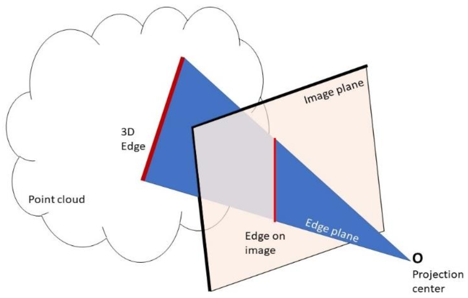
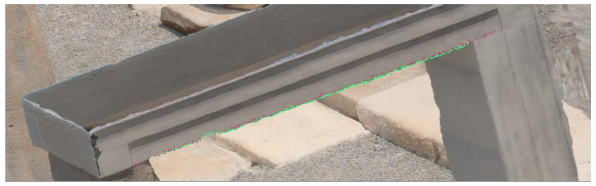
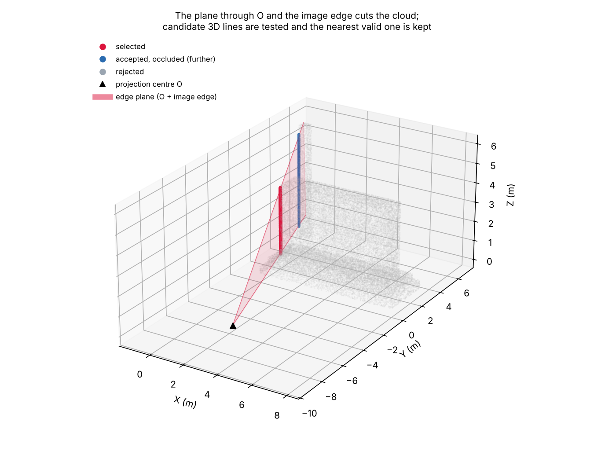
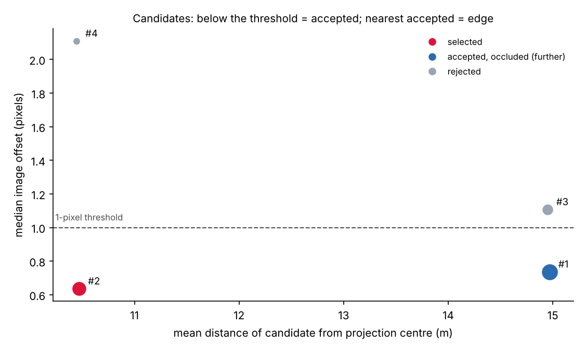

# Edge Detection in 3D Point Clouds Using Digital Images

**Semi-automated extraction of straight 3D edges from unorganised point clouds, guided by edges measured on oriented images.**
Built for the geometric documentation of cultural heritage, where drawing vector lines from point clouds is still mostly manual work.

Dipl.-Eng. thesis, School of Rural, Surveying & Geoinformatics Engineering, **National Technical University of Athens** (Laboratory of Photogrammetry), 2020.
**Supervisor: Prof. Andreas Georgopoulos**, Laboratory of Photogrammetry, NTUA.
Published as: **Dolapsaki, M.M.; Georgopoulos, A.** *Edge Detection in 3D Point Clouds Using Digital Images.* ISPRS Int. J. Geo-Inf. **2021**, 10, 229. [doi:10.3390/ijgi10040229](https://doi.org/10.3390/ijgi10040229)

[Paper (open access)](https://doi.org/10.3390/ijgi10040229) · [Thesis (DSpace@NTUA)](https://dspace.lib.ntua.gr/xmlui/handle/123456789/52017) · Python · NumPy · RANSAC · Photogrammetry

---

## The idea



An edge measured on an image, together with the image's **projection centre O**, defines a plane in object space: the **edge plane**. If the image's interior and exterior orientation are known, and the point cloud is in the same coordinate system, then **every point of the real 3D edge lies on that plane**.

The problem therefore becomes: *which of the points close to this plane form the edge I measured?*

1. **Image → object space.** Two points of the 2D edge, (x, y, −c), are transformed with the rigid-body transformation `P = O + Rᵀ·p` (Eq. 3 of the paper).
2. **Edge plane.** The plane through those two points and O is computed (Ax + By + Cz + D = 0). Cloud points within a distance threshold are kept.
3. **Candidate lines.** The plane cuts many surfaces, so the kept points contain several linear concentrations. 3D lines are extracted iteratively with **RANSAC**.
4. **Acceptance criteria.** Each candidate is back-projected with the collinearity equations and must
   - fall inside the 36 × 24 mm image frame and the measured edge's extent;
   - agree with the 2D edge line within ~1 pixel;
   - be the accepted candidate **nearest to the projection centre**, since edges further along the plane are hidden behind it.

<br clear="right">

## Results from the paper (Temple of Demeter, Naxos)

| | |
|---|---|
| Point cloud | 750,000 points (FARO terrestrial laser scanner) |
| Images | full-frame DSLR, oriented by SfM/MVS (Agisoft PhotoScan) |
| Threshold | 1 pixel ≈ 6 mm (mean GSD) |
| Time per edge | 25–30 s |
| Accuracy vs. scanner edge (M3C2, CloudCompare) | < 5 mm with the calibrated focal length |



*Detected 3D edge points (purple) compared to the real edge from the laser scanner (green). Figure from the paper, CC BY 4.0.*

The paper also shows how much the **calibrated focal length** matters: using the nominal 24 mm instead of the calibrated 24.5 mm shifts the bundle of rays enough to select the wrong points.

## Run it yourself (synthetic scene)

The Naxos data belongs to the NTUA Laboratory of Photogrammetry and is not included. Instead, `examples/synthetic_demo.py` builds a monument-like scene: two steps, a wall, and a column hidden behind the wall that lies on the same edge plane. It samples the scene as a noisy scanner cloud (2 cm spacing, 2 mm noise) and recovers a measured edge from a virtual 24.5 mm full-frame camera:

```bash
pip install -r requirements.txt
python examples/synthetic_demo.py
```

```
point cloud: 343,735 points
points within 6 mm of the edge plane: 1,482
  candidate #1:  454 pts, mean dist to O =  14.97 m, median image offset = 0.74 px, accepted = True
  candidate #2:  341 pts, mean dist to O =  10.47 m, median image offset = 0.64 px, accepted = True
  candidate #3:  196 pts, mean dist to O =  14.95 m, median image offset = 1.11 px, accepted = False
  candidate #4:   63 pts, mean dist to O =  10.45 m, median image offset = 2.11 px, accepted = False

selected edge: 341 points, distance from the true edge: RMS 2.9 mm, max 6.0 mm
```

<p>


</p>

The column's edge (#1) passes the image check. It is still rejected because it lies further along the plane, hidden behind the wall, which is exactly the occlusion case the "nearest to O" criterion handles.

### Use on your own data

```python
import numpy as np
from edge3d import Camera, detect_edge, rotation_matrix, save_xyz

cloud = np.loadtxt("cloud.xyz")[:, :3]
cam = Camera(c=0.0245, O=[X0, Y0, Z0],
             R=rotation_matrix(omega, phi, kappa, units="grad", order="kwp"))
res = detect_edge(cloud, p1=(x1, y1), p2=(x2, y2), cam=cam)   # image coords in metres
save_xyz(res.edge, "edge.xyz")                                 # open in CloudCompare
```

## How precisely is the edge plane defined?

`analysis/plane_error_propagation.py` propagates the image-measurement error to the plane parameters, both first-order (Σ = σ²JJᵀ) and by Monte Carlo. It uses the exterior orientation of image 4G0R6724 from the thesis and a 6 µm pixel:

| image measurement σ | RMS offset of plane at the edge, 5 m | 10 m | 20 m |
|---|---|---|---|
| 0.5 px | 0.5 mm | 1.0 mm | 1.9 mm |
| 1 px | 1.0 mm | 1.9 mm | 3.8 mm |
| 2 px | 1.9 mm | 3.9 mm | 7.7 mm |

At typical terrestrial distances, the plane is defined to a few millimetres, comparable to the scanner noise. Accurate 2D edge measurement and a calibrated camera are what limit the method.

## Repository structure

```
edge3d/                     refactored package (Python 3, NumPy only)
  geometry.py               rotation matrices, collinearity, image↔object, planes
  pipeline.py               edge plane, iterative RANSAC, acceptance criteria
  errors.py                 error propagation for the plane parameters
examples/synthetic_demo.py  end-to-end demo + figures
analysis/                   plane-precision study
tests/                      geometric and end-to-end tests
original_thesis_code_2019_2020/   the original thesis notebooks and scripts (Greek comments)
docs/figures/               figures (paper figures are CC BY 4.0)
```

The `edge3d` package is a 2026 clean rewrite of the original thesis code. It follows the same method, adds tests, removes the interactive CloudCompare loop, and swaps the scikit-image RANSAC for a small NumPy implementation. The original code is kept unchanged in `original_thesis_code_2019_2020/` (see its README).

## Citation

```bibtex
@article{dolapsaki2021edge,
  title   = {Edge Detection in 3D Point Clouds Using Digital Images},
  author  = {Dolapsaki, Maria Melina and Georgopoulos, Andreas},
  journal = {ISPRS International Journal of Geo-Information},
  volume  = {10}, number = {4}, pages = {229}, year = {2021},
  doi     = {10.3390/ijgi10040229}
}
```

## Acknowledgements

Supervised by Prof. Andreas Georgopoulos (Laboratory of Photogrammetry, NTUA). Also listed as contributors in the NTUA record: Anastasios Doulamis and Nikolaos Doulamis.

## License

Code: MIT. Figures taken from the paper: CC BY 4.0, © the authors.
